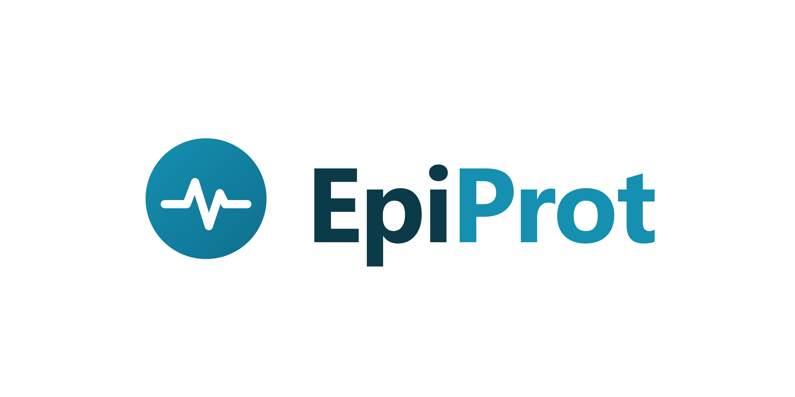

<p align="center"></p>

# EpiProt

**A wearable system that detects tonic-clonic (big convulsive) seizures while they happen, alerts a
caregiver with the location, watches over the patient after the seizure, and keeps a seizure diary
with raw brain, heart and movement signals for the doctor.**

| 98% | 0.24 / day | 46 s |
|:---:|:---:|:---:|
| tonic-clonic seizures detected (54 of 55) | false alarms per day (about 1 every 4 days) | median time from seizure onset to alarm |

Results on the SeizeIT2 wearable dataset (125 patients, 11,538 hours), patient-wise cross-validation:
every patient was tested by models that never saw them in training. Only data the EpiProt hardware provides
(headband EEG + headband movement + the watch's heart rate).

Robust to a failing watch: with the watch heart rate missing during every seizure 54/55, without a watch at all
53/55 (headband alone), with the heart-rate sensor stuck during seizures 53/55.

---

## The system has three parts, one folder each

```
 Headband  ── Bluetooth ──►  Phone app  ◄── Bluetooth ──►  Watch
 (EEG + head movement)       (the brain)                   (heart rate, movement, PIN)
                                │
                                ├── SMS + location ──► caregiver
                                └── PDF report (WhatsApp, e-mail ...) ──► doctor
```

### 📱 [`mobile-app/`](mobile-app/) — EpiProt phone app
The brain of the system. Everything that decides runs here.
- **Seizure detection model** (5 s + 30 s LightGBM models; backup models when the movement sensor or the watch
  heart rate is missing or stuck)
- **Alarm flow:** caregiver alerted at the moment of the alarm; a 4-digit PIN cancels a false alarm and sends a
  "false alarm" message; emergency message after 5 minutes; "Are you OK?" check-ins after the seizure
- **Sensor-health monitor:** warns on the watch when the headband or watch is not measuring properly
- **Event log** on the phone (encrypted) and, with consent, the signals from 2 min before to 5 min after each alarm
- **Doctor report** (PDF with charts and signal graphs), sent by the patient with any app when the doctor asks
- **Consent system:** first-start setup per country (Türkiye, EU, US), separate consents, privacy centre

Status: the Android app ([`mobile-app/android/`](mobile-app/android/), Kotlin) runs the full chain, verified
against the Python code (58 unit tests, 24 h endurance test); its demo replays a real recorded seizure. Tested on a
real phone with the watch app (Wear OS emulator) and with a second phone playing the headband over real Bluetooth.

### ⌚ [`watch-app/`](watch-app/) — EpiProt watch app
A small companion app on a Wear OS watch. It measures and shows; it does not decide.
- Sends live heart rate and wrist movement to the phone
- Vibrates on an alarm and asks for the PIN (checked on the watch)
- Shows the "Are you OK?" check-ins and the sensor warnings
- Warns by itself when the phone is out of reach (then there are no alarms)

Status: first version (Kotlin, Compose for Wear OS) with a demo mode. Builds, unit tests pass, runs on the Wear OS
emulator and was tested together with a real Android phone; not yet tested on a real watch.

### 🎧 [`device-firmware/`](device-firmware/) — the headband
Hardware design, Bluetooth protocol and 3D model of the headband, plus a software copy of it (simulator).
- 4-channel behind-the-ear EEG (2 used by the model, 2 backups) and head movement, exactly 256 / 25 samples per second
- Checks electrode contact; every 10 minutes measures each pad and asks for a new one before it dries out
- Streams to the phone over encrypted Bluetooth LE (paired once with a passkey), keeps ~40 minutes if the link drops
- 3D model on real head scans: two one-piece side bodies (ear hook, electrode module, pod) and a spring band at the
  nape; pressure, pillow contact, staying on and sizes calculated ([`device-firmware/cad/`](device-firmware/cad/))

Status: designed and simulated; no physical headband is built in this project.

---

## Where each piece of software runs

| Software part | Headband | Watch | Phone |
|---|:---:|:---:|:---:|
| Signal sampling, time stamps, electrode contact check | ✔ | ✔ | |
| Backup buffer if Bluetooth drops (headband ~40 min, watch ~10 min) | ✔ | ✔ | |
| Vibration, alarm screen, PIN entry and check | | ✔ | |
| Detection model | | | ✔ |
| Alarm and recovery flow, SMS to the caregiver | | | ✔ |
| Sensor-health monitor | | warnings | ✔ |
| Event log, signals around alarms (with consent), doctor report | | | ✔ |

The phone is the hub because all sensors meet there, the raw data for the event log arrives there anyway
(about 4 kB/s from the headband and the watch), and messages to the caregiver leave from the phone.

## How the parts talk to each other

| What | From → to | How |
|---|---|---|
| Brain signal + head movement | headband → phone | Bluetooth Low Energy; paired once, then reconnects automatically |
| Heart rate, movement, PIN result | watch ↔ phone | Wear OS Data Layer (Bluetooth) between the two EpiProt apps |
| Caregiver alert | phone → caregiver's phone | SMS with a map link of the location; numbers entered in the app |
| Doctor report | phone → doctor | PDF (summary, charts, event table, signal graphs) shared by the patient with any app (WhatsApp, e-mail ...), each time confirmed |

## Privacy

Health data stay on the patient's phone, encrypted (SQLCipher, key in the Android Keystore). Nothing is uploaded to
a server. Separate consents for processing, caregiver SMS, location and keeping signals; the doctor report is sent
only by the patient. Texts per country: KVKK (Türkiye), GDPR (EU), US federal and state rules. Details:
[`mobile-app/android/PRIVACY.md`](mobile-app/android/PRIVACY.md); what is still needed before real use:
[`docs/`](docs/).

## Disclaimer

EpiProt is a student research prototype (NYAS Junior Academy). It is not a certified medical device and does
not replace medical care.

## Data

Data: SeizeIT2 wearable dataset (CC0) – Bhagubai M. et al., "SeizeIT2: Wearable dataset of patients with focal
epilepsy", *Scientific Data* (2025); OpenNeuro ds005873, doi:10.18112/openneuro.ds005873.v1.1.0. The demo recording
and the test fixtures in `mobile-app/android` are derived from it.
