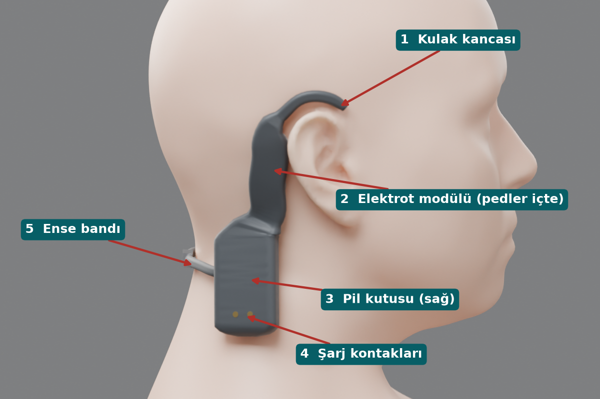
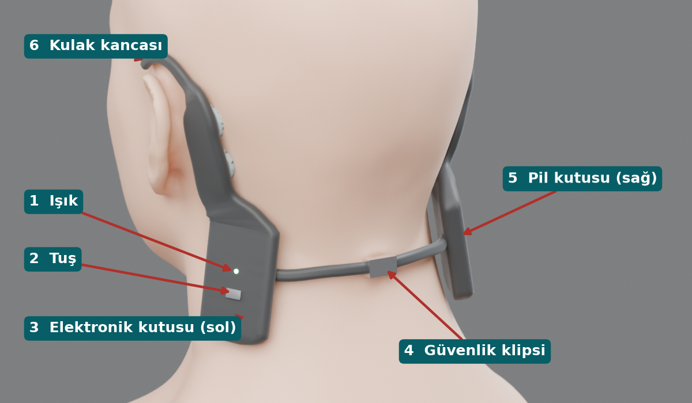
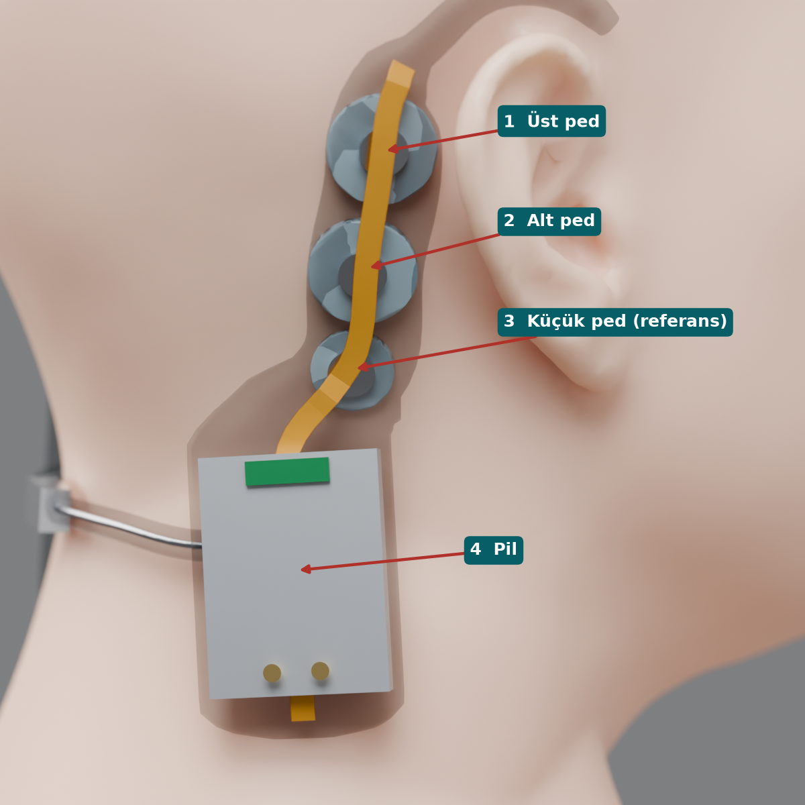

# EpiProt Kullanım Kılavuzu

**Hastalar, aileleri ve bakıcılar için**

Bu kılavuzu cihazı ilk kez kullanmadan önce baştan sona okuyun ve saklayın. Kutudan çıkan **6 haneli eşleştirme kodu kartını** kaybetmeyin; kafa bandını telefonunuza tanıtmak için gereklidir.

> **ÖNEMLİ:** EpiProt bir araştırma prototipidir, onaylı bir tıbbi cihaz değildir. Bazı nöbetleri kaçırabilir, nöbet olmadığı halde alarm verebilir. Doktorunuzun tedavisinin ve bir yakınınızın gözetiminin yerine geçmez. İlaçlarınızı ve doktorunuzun önerilerini kendi başınıza değiştirmeyin. Acil bir durumda beklemeden **112**'yi arayın.

## 1. EpiProt nedir?

EpiProt, uyurken ya da yalnızken geçirilen **büyük kasılmalı nöbetleri** (vücudun kasılıp sarsıldığı nöbetler, doktorların deyişiyle "tonik-klonik nöbet") fark edip yakınlarınıza hemen haber veren bir sistemdir. Üç parçadan oluşur:

- **Kafa bandı:** Kulaklarınızın üstüne gözlük gibi takılır. Kulaklarınızın arkasındaki küçük pedlerle beyninizden gelen çok küçük elektrik sinyallerini ve başınızın hareketini ölçer.
- **Akıllı saat:** Bileğinizde nabzınızı ve hareketinizi ölçer. Nöbet anında titreşir ve "iyiyseniz şifrenizi girin" diye sorar.
- **Telefon uygulaması:** Kafa bandından ve saatten gelen bilgileri her 5 saniyede bir inceler. Nöbet gibi görünen bir durum fark ederse bakıcınıza **SMS ve konumunuzu** gönderir.

**EpiProt neleri yapar:**

- Büyük kasılmalı bir nöbet başladığında genellikle bir dakika içinde bakıcınıza haber verir.
- Bakıcınızın telefonunda yüksek sesli alarm çaldırır (bakıcı da EpiProt uygulamasını kurduysa).
- Nöbet 5 dakikayı geçerse bakıcınıza "acil durum" mesajı gönderir.
- Nöbetten sonra bir süre "İyi misiniz?" diye sorar; cevap vermezseniz bakıcınıza tekrar haber verir.
- Nöbetlerinizin kaydını tutar ve doktorunuz için bir rapor hazırlar.

**EpiProt neleri YAPMAZ:**

- Yalnızca büyük kasılmalı nöbetleri algılamak için yapıldı. **Dalma, kısa kasılma ya da yalnızca bir kolda seyreden nöbetleri algılamaz.**
- 112'yi kendisi aramaz; bunu bakıcınızın yapması gerekir.
- Nöbeti önlemez ve tedavi etmez.
- Kafa bandı takılı değilken, şarjdayken ya da telefon kapalıyken çalışmaz.

## 2. Kimler kullanmamalı?

Aşağıdaki durumlardan biri sizin için geçerliyse **EpiProt'u kullanmayın ve önce doktorunuza danışın:**

- Kulak arkasına takılan bir işitme cihazı ya da koklear implant kullanıyorsanız (kafa bandı aynı yere oturur).
- Vagus sinir uyarıcısı (VNS) ya da vücudunuzda başka bir elektronik cihaz (kalp pili gibi) varsa.
- Kulaklarınızın arkasında yara, egzama, kızarıklık varsa ya da silikona alerjiniz varsa.
- 6 yaşından küçük çocuklarda.

**MR ya da röntgen çekiminden önce kafa bandını mutlaka çıkarın.** Kafa bandında metal parçalar ve pil vardır.

## 3. Kutuda neler var?

| Parça | Adet |
|---|---|
| EpiProt kafa bandı (S, M ya da L beden) | 1 |
| Mıknatıslı şarj aleti ve USB kablosu | 1 |
| Ped takımı (bir takım = 5 ped) | 6 takım (30 ped) |
| Eşleştirme kodu kartı (6 haneli kod) | 1 |
| Bu kılavuz | 1 |

**Ayrıca gerekenler:**

- Android telefon (Android 10 ya da daha yeni).
- Wear OS akıllı saat (Samsung Galaxy Watch4 ya da daha yeni, Google Pixel Watch). Saat kutuda yoktur.
- Bakıcınızın telefonu (bakıcının telefonuna da EpiProt'u kurmanızı öneririz; bkz. Bölüm 6.6).

## 4. Parçaları tanıyalım

- **Kulak kancası:** Kulağınızın üstüne gözlük sapı gibi oturur. Kafa bandının düşmesini önler.
- **Elektrot modülü:** Kulağınızın hemen arkasında durur. İç tarafında beyin sinyalini ölçen pedler vardır.
- **Elektronik kutusu (sol):** Kafa bandının beynidir. Üzerinde **tuş** ve **ışık** vardır.
- **Pil kutusu (sağ):** Pil buradadır. Altında **şarj kontakları** vardır.
- **Ense bandı:** İki tarafı ensenizin arkasından birbirine bağlar. Hafif bir yay gibi davranır ve pedleri cildinize nazikçe bastırır.
- **Güvenlik klipsi:** Ense bandının ortasındadır. Kafa bandı bir yere takılıp sert çekilirse açılır; böylece kulaklarınız ve boynunuz zorlanmaz. Tekrar birleştirmek için iki ucu birbirine yaklaştırın, mıknatıs yerine oturtur.

Her kulağınızın arkasında **iki ped** vardır (üst ve alt). Sağ tarafta bunların altında **küçük bir ped** daha vardır; bu ped sinyalin temiz ölçülmesine yardım eder. Sol taraftaki üçüncü yer boştur ve kapaklıdır.

## 5. Doğru bedeni seçme

1. Bir mezura ile başınızın çevresini ölçün: kaşlarınızın ve kulaklarınızın hemen üstünden, başınızın en geniş yerinden.
2. Bedeni seçin:

| Baş çevresi | Beden |
|---|---|
| 52 cm'den küçük (genellikle 6–12 yaş çocuklar) | **S** |
| 52–56 cm | **M** |
| 56 cm'den büyük | **L** |

3. Kafa bandını takıp kontrol edin (Bölüm 7.1): kancalar kulaklarınızın üstüne oturduğunda **pedler kulağınızın hemen arkasındaki kemiğin üzerinde** olmalı; kulağınıza ya da boynunuza değmemeli. Değiyorsa diğer bedeni deneyin.

## 6. İlk kurulum (yalnızca bir kere)

### 6.1 Telefon uygulamasını kurun

1. EpiProt uygulamasını telefonunuza kurun ve açın.
2. "Bu telefonu kim kullanacak?" sorusuna **"Hastayım"** cevabını verin.
3. Uygulama sizi kurulum adımlarından geçirir: ülkeniz, kararı kimin verdiği (18 yaşından küçükseniz anne-babanız), bilgilendirme metni, cihazın sınırları ve onaylar. Her ekranı okuyun. Nöbet takibi için **sağlık verisi onayı** gereklidir; bakıcıya SMS için ve konum için ayrı onaylar vardır.
4. Uygulama izin isterse (konum, SMS, bildirim, yakındaki cihazlar) **İzin ver**'e dokunun. İzin vermezseniz ilgili özellik çalışmaz.

### 6.2 Kendi bilgileriniz, bakıcılarınız ve şifreniz

Uygulamada **Ayarlar → Hasta ve bakıcılar** bölümüne girin:

1. Adınızı yazın (bakıcıya giden mesajlarda görünür).
2. En fazla 3 bakıcının telefon numarasını yazın. Her bakıcı için **"Bu kişi EpiProt uyarılarını almayı kabul etti"** kutusunu yalnızca o kişiye sorduktan sonra işaretleyin. Bakıcıya bir tanıtım SMS'i gider.
3. **Ayarlar → Saat PIN'i** bölümünde 4 haneli bir şifre belirleyin. Bu şifreyi yalnızca siz bilin. Yanlış alarmda saatten bu şifreyi girerek alarmı iptal edersiniz.

### 6.3 Saati hazırlayın

1. Saatinizi telefonunuza saatin kendi uygulamasıyla (Galaxy Wearable ya da Pixel Watch uygulaması) eşleştirin.
2. Saate EpiProt saat uygulamasını kurun ve açın. "Vücut sensörleri" iznini verin.
3. Saat ekranında **"Telefon bağlı"** yazısını görmelisiniz.

### 6.4 Kafa bandını şarj edin

İlk kullanımdan önce kafa bandını tam şarj edin (yaklaşık 2 saat). Şarj aletini pil kutusunun altındaki kontaklara yaklaştırın; mıknatıs kendiliğinden yerine oturtur. Şarj olurken ışık **sarı yanar**, dolunca **yeşil yanar**.

### 6.5 Kafa bandını telefonunuza tanıtın (eşleştirme)

1. Kafa bandını şarjdan çıkarın; kendiliğinden açılır (ışık 3 kez yeşil yanıp söner).
2. Telefonda **Ayarlar → Kafa bandı** bölümüne girin.
3. Sol kutudaki **tuşa 2 saniye basılı tutun**; ışık **mavi yanıp sönmeye** başlar.
4. Telefonda **"Kafa bandını eşleştir"**'e dokunun.
5. Telefon bir kod sorar: kutudaki karttaki **6 haneli kodu** girin.
6. Ekranda **"Bağlı"** yazısını görürsünüz. Bu işlem bir kere yapılır; sonra kafa bandı her açıldığında telefona kendiliğinden bağlanır.

> **Kod neden gerekli?** Kod, yalnızca sizin telefonunuzun kafa bandına bağlanabilmesini sağlar. Yakındaki başka biri beyin sinyallerinizi okuyamaz ve sahte bilgi gönderemez.

### 6.6 Bakıcınızın telefonunu hazırlayın (önerilir)

Bakıcınızın telefonu nöbet anında **sessizdeyken bile yüksek sesle çalsın** istiyorsanız:

1. Bakıcınız EpiProt uygulamasını kendi telefonuna kurar ve **"Bakıcıyım"** seçer.
2. **"Adınız"** bölümüne kendi adını yazar (hastanın saatinde "Mehmet geliyor" gibi görünür).
3. **"Takip ettiğim hastalar"** bölümüne sizin adınızı ve telefon numaranızı yazar. (Sizin uygulamanız ona tanıtım SMS'i gönderdiyse, gelen bildirime dokunarak numaranızı hazır olarak da ekleyebilir.)
4. **"Alarm çalabilecek mi?"** listesindeki her maddede **İzin ver**'e dokunur: SMS okuma, hastaya "geliyorum" demek (SMS gönderme), bildirim, "Rahatsız Etmeyin" açıkken de çalma, kilit ekranında tam ekran alarm.
5. Telefonu sessize alıp **"Alarmı dene"**'ye dokunur. Telefon yüksek sesle çalmalı. **Gidiyorum – alarmı sustur** ile susturur.

Bakıcınız uygulamayı kurmazsa da normal SMS alır; ama telefonu sessizdeyse mesajı geç fark edebilir.

### 6.7 Gerçek SMS'i açın

Uygulama başta **deneme modundadır**: bakıcıya giden mesajlar gönderilmez, yalnızca uygulamada gösterilir. Her şeyi denedikten sonra **Ayarlar → Bakıcı mesajları → Gerçek SMS gönder**'i açın.

### 6.8 Takibi başlatın

Ana ekranda **"İzlemeyi başlat"**'a dokunun. Ekranda **"Koruma açık"** yazısı, saat ve kafa bandı için **"bağlı"** görünmelidir. Telefonunuz yeniden başlasa bile takip kendiliğinden devam eder.

Bazı telefon markaları (özellikle Xiaomi, Samsung, Huawei, Oppo) arka plandaki uygulamaları kapatabilir. **Ayarlar → EpiProt'u açık tut** bölümündeki adımları mutlaka uygulayın.

## 7. Her gün

### 7.1 Kafa bandını takma

1. Pedlerin yerinde olduğunu ve kurumadığını kontrol edin (ped biraz nemli ve yumuşak olmalı).
2. Kafa bandını iki elinizle pil ve elektronik kutularından tutun ve hafifçe açın.
3. Kancaları önce bir kulağınızın, sonra diğer kulağınızın üstüne yerleştirin.
4. Elektrot modüllerinin kulaklarınızın hemen arkasında durduğundan emin olun. Pedler kulağınızın arkasındaki kemiğe değmeli. Saçınız varsa pedlerin altına girmemesi için saçınızı kenara alın.
5. Ense bandı ensenizin arkasında, hafifçe boşta durur. Klipsin kapalı olduğunu kontrol edin.
6. Işığın **10 saniyede bir yeşil** yanıp söndüğünü görün (aynada ya da bir yakınınız bakarak).
7. Telefonda **Ayarlar → Kafa bandı** bölümünde bütün pedler **yeşil** olmalı. Bir ped sarı ya da kırmızıysa onu cildinize doğru hafifçe bastırın ya da değiştirin.

Kafa bandı hafifçe bastırır; bu normaldir. Ağrı, yanma ya da kızarıklık olursa çıkarın ve doktorunuza danışın.

### 7.2 Kafa bandını çıkarma

Kafa bandını iki kutusundan tutup hafifçe açın ve kancaları kulaklarınızdan kaldırarak çıkarın. Ense bandından ya da kancalardan tek elle çekmeyin. Çıkardığınızda takip durur; saatiniz bunu size söyler.

### 7.3 Uyurken

- Kafa bandını ve saati gece takın; büyük kasılmalı nöbetler en çok uykuda tehlikelidir.
- Sırtüstü ve yan yatabilirsiniz. Pil ve elektronik kutuları boynunuzun yan tarafında, yastığa değmeyecek bir yerdedir. Yan yatarken kulak üstündeki kanca, gözlükle yatmak gibi hafifçe hissedilebilir.
- **Gece modu:** Telefonda **Ayarlar → Saatte gece modu** bölümünden saat aralığını seçin (örneğin 23:00–07:00). Gece önemsiz uyarılar saatinizi titretmez, sabah özet olarak gösterilir. **Nöbet alarmı ve takibin durduğunu söyleyen uyarılar gece de titreştirir.**

### 7.4 Şarj

- Kafa bandının pili yaklaşık **2 gün** dayanır; şarj olması yaklaşık **2 saat** sürer.
- **Şarj olurken kafa bandı başınızda değildir ve nöbet takibi YAPILMAZ.** Saatiniz "Kafa bandı şarjda, nöbet tespiti çalışmıyor" der.
- Bu yüzden kafa bandını gündüz, yanınızda biri varken şarj edin (örneğin duş alırken, kahvaltıda). Gece şarj etmeyin.
- Pil %15'in altına düşünce saatiniz ve telefonunuz uyarır; %2'de "hemen şarj edin" diye titreşerek uyarır.
- Saatinizi de her gün şarj edin. Saat şarjdayken nabız ölçülemez; takip kafa bandıyla devam eder.
- Telefonunuzun pili %20'nin altına düşünce uyarı gelir. **Telefon kapanırsa hiçbir alarm çalışmaz.** Telefonunuzu her gece şarja takın.

## 8. Pedler

Pedler beyin sinyalini cildinizden alan küçük, yumuşak parçalardır. Zamanla kururlar.

**Ne zaman değiştirilir?**

- En geç **5 günde bir**, ya da
- Uygulama ya da saat **"pedi değiştirin, kuruyor"** dediğinde (kafa bandı pedleri 10 dakikada bir kendisi ölçer).

**Nasıl değiştirilir?**

1. Kafa bandını çıkarın.
2. Eski pedi kenarından tutup çıtçıttan çekerek çıkarın.
3. Yeni pedin koruyucu filmini soyun ve çıtçıta "klik" sesi gelene kadar bastırın.
4. Beş pedin hepsini (her kulak için üst ve alt, sağdaki küçük ped) birlikte değiştirin.
5. Kafa bandını takın ve uygulamada **Ayarlar → Kafa bandı → "Yeni pedleri taktım"**'a dokunun. Uygulama temas ölçümünü hemen yapar ve yedek ped sayınızı günceller.

Yedek pedleri serin ve kuru bir yerde, ambalajında saklayın. Yedek ped 10'un altına düşünce uygulama sizi uyarır. Pedler tek kullanımlıktır, yıkayıp tekrar kullanmayın.

## 9. Nöbet olduğunda ne olur?

### Hastanın tarafı

1. Saatiniz güçlü titreşir ve kırmızı ekranda **"Nöbet algılandı. Bakıcı uyarıldı. İyiyseniz PIN girin"** yazar.
2. Bakıcınıza o anda konumunuzla birlikte SMS gider; bakıcınızın telefonunda alarm çalar.
3. **Nöbet geçirmiyorsanız (yanlış alarm):** 30 saniye içinde saatten 4 haneli şifrenizi girin. Alarm durur ve bakıcınıza "Yanlış alarm, iyi" mesajı gider; bakıcınızın telefonundaki alarm da kendiliğinden susar.
4. Şifre girilmezse alarm devam eder ve bakıcınız size doğru yola çıkar.
5. Nöbet **5 dakikayı geçerse** bakıcınıza **acil durum** mesajı gider.
6. Nöbet bitince saatiniz **5 dakikada bir "İyi misiniz?"** diye sorar. Kendinize gelince şifrenizi girin.
7. Bakıcınız "Gidiyorum"a dokunduysa saatinizde **"(bakıcınızın adı) geliyor"** yazar; telefonunuzun ana ekranındaki alarm kartında da görünür.
8. Nöbetten **15 dakika** sonra hâlâ cevap vermediyseniz bakıcınıza tekrar haber verilir. **60 dakika** cevap gelmezse takip bakıcınıza devredilir.

### Bakıcının yapması gerekenler

1. Alarm geldiğinde **"Gidiyorum – alarmı sustur"**'a dokunun ve hemen hastanın yanına gidin. Telefonunuz hastanın telefonuna otomatik olarak "geliyorum" mesajı gönderir: hastanın saatinde **"(adınız) geliyor"** yazar, diğer bakıcılar da sizin yola çıktığınızı öğrenir. Onların alarmı yine de çalar; böylece siz gidemezseniz başkası hâlâ uyarılmış olur. **Konumu aç** ile konumu, **Hastayı ara** ile hastayı arayabilirsiniz.
2. Nöbet sırasında:
   - Sakin olun, kişinin yanında kalın ve saati not edin.
   - Kişiyi yan yatırın (yüzü hafifçe aşağı bakacak şekilde) ve başının altına yumuşak bir şey koyun.
   - Etrafındaki sert ve sivri eşyaları kaldırın.
   - **Ağzına hiçbir şey koymayın**, kişiyi tutmaya ya da sarsıntıyı durdurmaya çalışmayın.
3. **112'yi arayın:** nöbet 5 dakikadan uzun sürerse, nöbetler arka arkaya gelirse, kişi kendine gelmezse, nefes almakta zorlanırsa, yaralandıysa ya da suda nöbet geçirdiyse. Doktorunuz bir kurtarma ilacı verdiyse onun söylediği gibi kullanın.
4. Kişi kendine gelince hastanın telefonunun ana ekranındaki alarm kartında **"Hastanın yanındayım: Nöbetti / Nöbet değildi"** düğmelerinden birine dokunun. Bu, doktor raporu için önemlidir.

## 10. Saatten yardım çağırma

Kendinizi kötü hissederseniz (örneğin nöbet öncesi bir his) bakıcınızı kendiniz çağırabilirsiniz:

1. Saatin ana ekranında kırmızı **"Yardım çağır"** düğmesine dokunun.
2. Ekranda **5 saniyelik geri sayım** başlar. Yanlışlıkla bastıysanız **İptal**'e dokunun.
3. Süre dolunca bakıcınıza konumunuzla birlikte "yardım istiyor" mesajı gider ve bakıcınızın telefonunda alarm çalar.
4. Güvenli bir yere oturun ya da uzanın.

Telefonunuz yanınızda değilse saat **"Telefon bağlı değil"** der; mesaj telefon bağlanınca gider. Bu durumda yakınınızdaki birinden yardım isteyin.

### Duş modu

Banyo, epilepsisi olan biri için evin en riskli yerlerinden biridir; ama duşta kafa bandı takılı olmadığı için nöbet algılanamaz. **Duş modu** bu boşluğu kapatır:

1. Kafa bandını çıkarın (isterseniz şarja takın). **Saati takılı bırakın**; saat suya dayanıklıdır.
2. Saatin ana ekranında **"Duş modu"**'na dokunun ve duşun süresini seçin (10, 15, 20 ya da 30 dakika).
3. Duştan çıkınca saatte **"Çıktım"**'a dokunun. Kimseye mesaj gitmez.
4. Süre dolduğunda saat titreşir ve **"Duştan çıktınız mı?"** diye sorar. **2 dakika içinde cevap vermezseniz** bakıcınıza "duştan sonra cevap vermiyor, kontrol edin" mesajı gider ve bakıcınızın telefonunda alarm çalar.
5. Bakıcınıza haber verildikten sonra iyiyseniz saatte **"İyiyim"**'e dokunun; bakıcınıza "duştan çıktı ve iyi" mesajı gider ve alarmı susar.

Saatin pili biterse ya da telefonla bağlantısı koparsa telefon süreyi kendisi takip eder ve gerekirse bakıcınıza yine haber verir.

**Banyoda güvenlik:** Küvete girmeyin, duş alın. Kapıyı kilitlemeyin. Evde biri varken duş almaya çalışın. Suyu çok sıcak yapmayın.

## 11. Uyarılar ve ne yapmalı

Uyarılar saatinizde, önemli olanlar telefonunuzda da görünür. Uyarı düzelince kendiliğinden kalkar.

| Uyarı | Ne yapmalı |
|---|---|
| Kafa bandı veri göndermiyor (nöbet alarmı ÇALIŞMAZ) | Kafa bandının açık, takılı ve şarjlı olduğunu kontrol edin. Işık sarıysa telefonu yaklaştırın. |
| Beyin sinyali zayıf | Kafa bandını düzeltin, pedlerin cildinize değdiğinden emin olun. |
| Cilt teması yok: (ped adı) | O pedi cildinize bastırın ya da değiştirin. Diğer pedler çalıştığı için takip genellikle devam eder. |
| Pedi değiştirin: kuruyor | O pedi (ya da hepsini) yenileyin. |
| Kafa bandının pili azaldı / bitmek üzere | Kafa bandını şarj edin (yanınızda biri varken). |
| Kafa bandı şarjda (nöbet tespiti ÇALIŞMIYOR) | Normaldir; şarj bitince kafa bandını takın. |
| Kafa bandı uygulamadan kapatıldı / bağlantı kesildi | Tekrar açın ya da uygulamada **Bağlan**'a dokunun. |
| Kafa bandının yazılımı güncelleniyor (nöbet tespiti ÇALIŞMIYOR) | Kafa bandını şarjda bırakın; bitince takın. |
| Telefonun pili azaldı / bitmek üzere | Telefonu şarja takın. |
| Saatin pili azaldı | Saati şarj edin. |
| Nabız ölçülemiyor | Saat kayışını biraz sıkın; saat bileğinize tam otursun. |
| Saatin verileri telefona ulaşmıyor | Telefonu yakınınızda tutun. |
| Telefon bağlı değil (saatte) | Telefonu yakınınızda ve EpiProt uygulamasını açık tutun. **Telefon bağlı değilken nöbet alarmı çalışmaz.** |
| Bakıcıya SMS gitmedi (telefonda) | Telefonunuzda çekim olmayabilir. Gerekirse bakıcınızı arayın. |
| Pedler 5 gündür değiştirilmedi / yedek ped azaldı | Yeni ped takın / yeni ped sipariş edin. |

## 12. Işığın anlamı

Işık sol kutunun üzerindedir. Kısa yanıp söner; gece sizi rahatsız etmez.

| Ne görüyorsunuz | Anlamı |
|---|---|
| Işık yok | Kafa bandı kapalı ya da pili tamamen bitmiş |
| 3 kez yeşil | Kafa bandı açılıyor |
| 10 saniyede bir kısa yeşil | Her şey yolunda, telefona bağlı |
| 2 saniyede bir sarı | Açık ama telefona bağlı değil (telefon uzakta, Bluetooth kapalı ya da uygulama kapalı) |
| Hızlı mavi | Eşleştirme modu, telefonu bekliyor |
| 10 saniyede bir kırmızı | Pil azaldı, yakında şarj edin |
| 2 saniyede bir kırmızı | Pil bitmek üzere, hemen şarj edin |
| Sürekli sarı (şarjdayken) | Şarj oluyor |
| Sürekli yeşil (şarjdayken) | Şarj doldu |
| 3 hızlı kırmızı, duraklama, tekrar | Arıza. Kafa bandını şarja takıp çıkararak yeniden başlatın; düzelmezse destek alın. |
| 5 saniye hızlı beyaz | Uygulamada "Kafa bandımı bul"'a dokundunuz |

## 13. Nöbet günlüğü ve doktor raporu

**Elle nöbet ekleme:** Kafa bandı takılı değilken (örneğin şarjdayken) bir nöbet geçirdiyseniz ya da cihaz bir nöbeti kaçırdıysa, uygulamada **Olaylar → Nöbet ekle**'ye dokunun. Nöbetin zamanını, türünü, kafa bandının takılı olup olmadığını ve isterseniz bir not yazın (örneğin "ilacımı unutmuştum", "az uyumuştum"). Kafa bandı takılıyken kaçırılan büyük nöbetler raporda ayrıca gösterilir; bunu doktorunuza da söyleyin.

**Doktor raporu:** **Olaylar → Doktoruma rapor gönder** bölümünde bir zaman aralığı seçin. Uygulama nöbetlerin sayısını, saatlerini, sürelerini, yanlış alarmları ve isterseniz nöbet anındaki sinyallerin grafiklerini içeren bir PDF hazırlar. Raporu WhatsApp, e-posta gibi istediğiniz bir yolla doktorunuza **siz** gönderirsiniz; her seferinde size sorulur.

## 14. Kapatma, bağlantıyı kesme, yeni telefon

Kafa bandının tuşu onu **kapatmaz**. Bu bilerek böyle yapıldı: uykuda yastık ya da nöbet sırasında bir çarpma kafa bandını yanlışlıkla kapatamasın. Telefonda **Ayarlar → Kafa bandı** bölümünde:

- **Bağlan:** Kafa bandı bağlı değilken görünür. Telefon zaten kendiliğinden bağlanmaya çalışır; bu düğme size kolaylık içindir.
- **Bağlantıyı kes:** Kafa bandı açık kalır ama telefon onu kullanmaz. **Nöbet takibi durur.**
- **Kafa bandını kapat:** Kafa bandı kapanır. Tekrar açmak için şarja takıp çıkarın ya da tuşa 2 saniye basın.
- **Eşleştirmeyi kaldır:** Telefon bu kafa bandını unutur. Yeni bir telefona geçerken ya da kafa bandını değiştirirken kullanın. Yeni telefonda eşleştirme kodu tekrar gerekir.
- **Kafa bandımı bul:** Kafa bandının ışığı 5 saniye beyaz yanıp söner.

Bu işlemlerin her biri "Emin misiniz?" diye sorar. Saatiniz de nöbet takibinin durduğunu hemen söyler.

**Kafa bandının yazılımını güncelleme:** Kafa bandının içindeki program zaman zaman iyileştirilir. Yeni sürüm EpiProt uygulamasının güncellemesiyle gelir; **Ayarlar → Kafa bandı → Kafa bandı yazılımı** bölümünde "Güncelleme var" yazar. Güncelleme yalnızca kafa bandı **şarjdayken** ve pili en az **%30** iken yapılır, siz **"Şimdi güncelle"**'ye dokunup onaylamadan asla başlamaz. 1–3 dakika sürer; bu sırada kafa bandını şarjda, telefonu yakında tutun. Güncelleme sırasında nöbet takibi yapılmaz, saatiniz bunu söyler. Bir sorun olursa kafa bandı eski sürümüyle çalışmaya devam eder. Kafa bandı yalnızca üreticinin imzaladığı yazılımı kabul eder.

**Yeni telefona geçerken:** Eski telefonda "Eşleştirmeyi kaldır"'a dokunun. Yeni telefona EpiProt'u kurun, kurulumu yapın ve kafa bandını yeniden eşleştirin (Bölüm 6.5). Bakıcılarınız yeni numaranızı kendi uygulamalarına eklemelidir.

## 15. Temizlik, su ve saklama

- Kafa bandını haftada bir, pedleri çıkardıktan sonra hafif nemli bir bezle ya da alkollü mendille silin. Kurulayın.
- Kafa bandı tere ve yağmura dayanıklıdır, ama **duşta, banyoda ve yüzerken takmayın.** Islak pedler beyin sinyalini okuyamaz. Suya batırmayın. Duş için **Duş modu**'nu kullanın (Bölüm 10).
- Şarj kontaklarını kuru tutun; şarj etmeden önce silin.
- Güneşte, arabada ya da ısıtıcının yanında bırakmayın. Bükmeyin, üzerine oturmayın (ense bandı esnektir, ama zorlamayın).
- Çocukların ulaşamayacağı yerde saklayın; pedler ve küçük parçalar yutulabilir.
- Uçakta ve seyahatte kullanabilirsiniz. Pil ve şarj aletini el bagajınızda taşıyın.
- Kafa bandı kırılırsa, şişerse, ısınırsa ya da yanık kokusu gelirse hemen çıkarın ve kullanmayın.

## 16. Sık sorulan sorular ve sorun giderme

**Kafa bandı telefona bağlanmıyor.**
Kafa bandının açık olduğundan emin olun (ışık yanıyor mu?). Telefonun Bluetooth'unun açık olduğunu kontrol edin. Telefonu kafa bandına yaklaştırın. Hâlâ bağlanmıyorsa uygulamada **Bağlan**'a dokunun. Uygulama eşleştirme isterse kartı kullanın.

**Eşleştirme olmuyor.**
Işığın mavi yanıp söndüğünden emin olun (tuşa 2 saniye basın). Kodu dikkatle girin. Kafa bandı başka bir telefonla eşleştirilmişse önce o telefonda "Eşleştirmeyi kaldır"'a dokunun.

**Ped uyarısı geçmiyor.**
Pedi cildinize bastırın, saçı altından çekin. Ped kurumuşsa değiştirin. Kulak arkasını sabunlu suyla yıkayıp kurulamak teması iyileştirir; krem ya da yağ sürmeyin.

**Saatte "Telefon bağlı değil" yazıyor.**
Telefonunuzu yakınınızda tutun, EpiProt uygulamasının açık olduğundan ve telefonun saate bağlı olduğundan emin olun. Telefonunuzu yeniden başlatmak çoğu zaman sorunu çözer.

**Bakıcımın telefonunda alarm çalmadı.**
Bakıcınızın uygulamasında "Alarm çalabilecek mi?" listesinin hepsinin işaretli olduğunu, sizin numaranızın "Takip ettiğim hastalar" listesinde doğru yazıldığını ve sizin uygulamanızda **gerçek SMS**'in açık olduğunu kontrol edin. "Alarmı dene" ile deneyin.

**Çok yanlış alarm geliyor.**
Yanlış alarmlarda saatten şifrenizi girin; bunlar kaydedilir. Kafa bandının iyi oturduğundan ve pedlerin taze olduğundan emin olun. Yanlış alarmlar devam ederse doktorunuza söyleyin.

**Gözlükle birlikte takılır mı?**
Evet. Önce kafa bandını, sonra gözlüğü takın. Gözlük sapı kancanın hemen yanına oturur. Rahatsız ederse doktorunuza ya da destek ekibine danışın.

**Pil çok çabuk bitiyor.**
Kafa bandını uzun süre telefondan uzakta bırakmak pili daha çok harcar. Pil 1 günden kısa dayanıyorsa destek alın.

**Kafa bandı rahatsız ediyor.**
Doğru bedeni kullandığınızdan emin olun (Bölüm 5). Ağrı, kızarıklık ya da baş ağrısı olursa kullanmayı bırakın ve doktorunuza danışın.

## 17. Gizlilik

- Bilgileriniz yalnızca **sizin telefonunuzda**, şifrelenmiş olarak saklanır. Hiçbir sunucuya gönderilmez.
- Kafa bandı ile telefon arasındaki bağlantı şifrelidir (eşleştirme kodu sayesinde).
- Bakıcınıza yalnızca alarm anında, sizin izin verdiğiniz bilgiler (adınız, saat, izin verdiyseniz konumunuz) gider.
- Doktor raporunu yalnızca siz gönderirsiniz.
- **Ayarlar → Gizlilik ve onaylar** bölümünden onaylarınızı istediğiniz zaman değiştirebilir, verilerinizi indirebilir ya da hepsini silebilirsiniz.

## 18. Teknik bilgiler

| | |
|---|---|
| Ağırlık | yaklaşık 58 g |
| Pil | şarj edilebilir, yaklaşık 2 gün; şarj süresi yaklaşık 2 saat |
| Bağlantı | Bluetooth, şifreli; telefondan uzaktayken yaklaşık 40 dakikalık veriyi saklar ve sonra gönderir |
| Ölçtükleri | beyin sinyali (kulak arkasından, 4 ped + 1 küçük ped), baş hareketi |
| Malzeme | dışı tıbbi silikon, içi sert plastik, içinde nikel içermeyen titanyum tel |
| Bedenler | S (yaklaşık 6–12 yaş), M, L |
| Ter ve yağmur | dayanıklı; duşta ve suda kullanılmaz |
| Telefon | Android 10 ya da daha yeni |
| Saat | Wear OS (Galaxy Watch4 ve sonrası, Pixel Watch) |

## 19. Güvenlik özeti

- EpiProt bir araştırma prototipidir; onaylı bir tıbbi cihaz değildir. Nöbetleri kaçırabilir ve yanlış alarm verebilir.
- Yalnızca büyük kasılmalı nöbetleri algılar.
- Kafa bandı takılı değilken, şarjdayken, telefon kapalıyken ya da telefon uzaktayken alarm **çalışmaz**.
- Kafa bandını gece şarj etmeyin; gündüz yanınızda biri varken şarj edin.
- Telefonunuzu her gece şarja takın.
- MR ve röntgenden önce kafa bandını çıkarın. Duşta ve suda kullanmayın.
- Acil bir durumda beklemeden **112**'yi arayın.

---

*EpiProt öğrenci araştırma projesidir (NYAS Junior Academy). Kafa bandı görselleri, NIOSH dijital kafa modeli (NIOSH NPPTL, NIH 3D Print Exchange 3DPX-015142, CC-BY) üzerinde hazırlanmıştır.*
