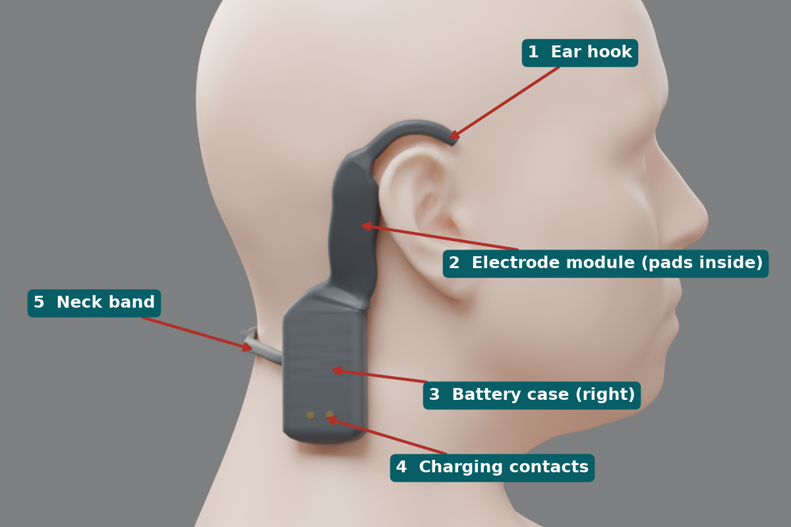
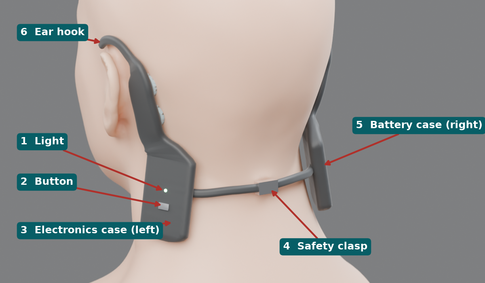
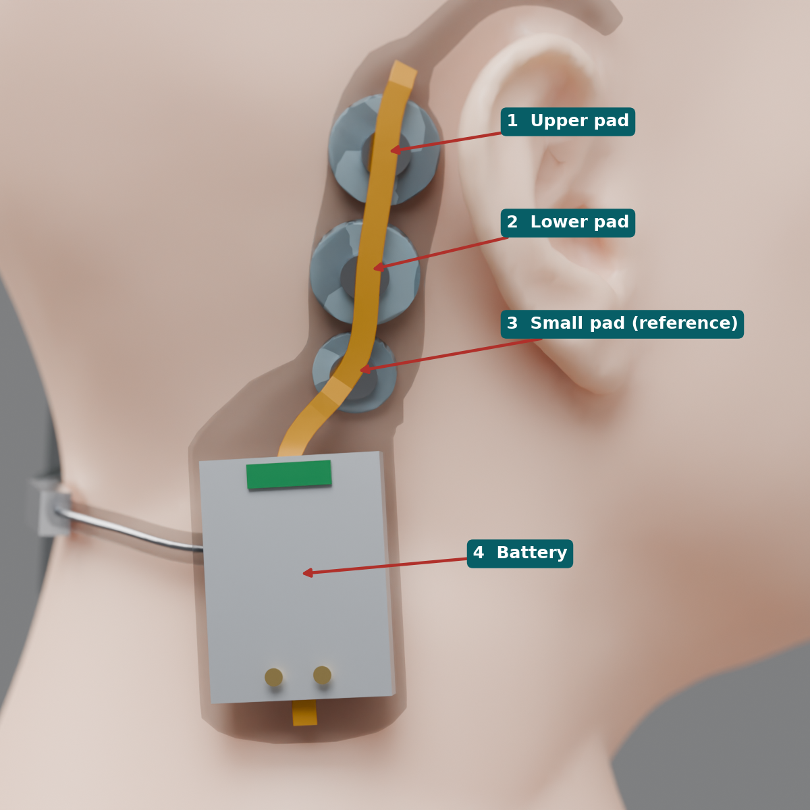

# EpiProt User Manual

**For patients, families and caregivers**

Read this manual from start to finish before you use the device for the first time, and keep it. Do not lose the **card with the 6-digit pairing code** that comes in the box; you need it to connect the headband to your phone.

> **IMPORTANT:** EpiProt is a research prototype, not an approved medical device. It can miss seizures, and it can raise an alarm when there is no seizure. It does not replace your doctor's treatment or the care of someone close to you. Do not change your medicines or your doctor's advice on your own. In an emergency, call **112** (or your local emergency number) without waiting.

## 1. What is EpiProt?

EpiProt notices **big convulsive seizures** (seizures in which the whole body stiffens and jerks; doctors call them "tonic-clonic seizures") during sleep or when you are alone, and tells the people close to you at once. It has three parts:

- **Headband:** worn over your ears like glasses. Small pads behind your ears measure the very small electrical signals of your brain and the movement of your head.
- **Smartwatch:** measures your pulse and movement on your wrist. During a seizure it vibrates and asks "if you are OK, enter your PIN".
- **Phone app:** looks at the data from the headband and the watch every 5 seconds. If something looks like a seizure, it sends your caregiver an **SMS with your location**.

**What EpiProt does:**

- When a big convulsive seizure starts, it usually alerts your caregiver within about a minute.
- It rings a loud alarm on your caregiver's phone (if the caregiver has installed the EpiProt app too).
- If the seizure lasts longer than 5 minutes, it sends your caregiver an "emergency" message.
- After the seizure it asks "Are you OK?" for a while; if you do not answer, it alerts your caregiver again.
- It keeps a record of your seizures and makes a report for your doctor.

**What EpiProt does NOT do:**

- It is made to detect only big convulsive seizures. **It does not detect absences, short jerks or seizures that affect only one arm.**
- It does not call 112 by itself; your caregiver has to do that.
- It does not prevent or treat seizures.
- It does not work while the headband is not worn, while it is charging or while the phone is off.

## 2. Who must not use it?

If one of the following applies to you, **do not use EpiProt and talk to your doctor first:**

- You wear a behind-the-ear hearing aid or a cochlear implant (the headband sits in the same place).
- You have a vagus nerve stimulator (VNS) or another electronic device in your body (such as a pacemaker).
- You have a wound, eczema or redness behind your ears, or you are allergic to silicone.
- Children under 6 years.

**Always take the headband off before an MRI scan or an X-ray.** The headband contains metal parts and a battery.

## 3. What is in the box?

| Item | Quantity |
|---|---|
| EpiProt headband (size S, M or L) | 1 |
| Magnetic charger and USB cable | 1 |
| Pad sets (one set = 5 pads) | 6 sets (30 pads) |
| Pairing code card (6-digit code) | 1 |
| This manual | 1 |

**You also need:**

- An Android phone (Android 10 or newer).
- A Wear OS smartwatch (Samsung Galaxy Watch4 or newer, Google Pixel Watch). The watch is not in the box.
- Your caregiver's phone (we recommend installing EpiProt on it too; see section 6.6).

## 4. Getting to know the parts

- **Ear hook:** rests over your ear like the arm of a pair of glasses. It keeps the headband from falling off.
- **Electrode module:** sits right behind your ear. The pads that measure the brain signal are on its inner side.
- **Electronics case (left):** the brain of the headband. It has the **button** and the **light**.
- **Battery case (right):** holds the battery. The **charging contacts** are at its bottom.
- **Neck band:** joins the two sides behind your neck. It works like a light spring and presses the pads gently against your skin.
- **Safety clasp:** in the middle of the neck band. If the headband gets caught and is pulled hard, it opens, so your ears and neck are not strained. To close it, bring the two ends together; a magnet snaps them into place.

Behind each ear there are **two pads** (upper and lower). On the right side there is also a **small pad** below them; it helps to measure a clean signal. The third place on the left side is empty and covered.

## 5. Choosing the right size

1. Measure around your head with a tape measure: just above your eyebrows and ears, where your head is widest.
2. Choose the size:

| Head circumference | Size |
|---|---|
| less than 52 cm (usually children aged 6–12) | **S** |
| 52–56 cm | **M** |
| more than 56 cm | **L** |

3. Put the headband on and check (section 7.1): with the hooks resting on your ears, **the pads must sit on the bone right behind your ear**, not on your ear and not on your neck. If they do not, try the other size.

## 6. First setup (only once)

### 6.1 Install the phone app

1. Install the EpiProt app on your phone and open it.
2. To the question "Who will use this phone?", answer **"I am the patient"**.
3. The app takes you through the setup: your country, who makes the decisions (your parents if you are under 18), the privacy notice, the limits of the device and the consents. Read every screen. Seizure monitoring needs the **health-data consent**; SMS to caregivers and the location have their own consents.
4. When the app asks for permissions (location, SMS, notifications, nearby devices), tap **Allow**. Without a permission, the feature that needs it does not work.

### 6.2 Your details, your caregivers and your PIN

In the app, open **Settings → Patient & caregivers**:

1. Enter your name (it appears in the messages to your caregiver).
2. Enter the phone numbers of up to 3 caregivers. For each one, tick **"This person agreed to receive EpiProt alerts"** only after you have asked that person. The caregiver receives an introduction SMS.
3. In **Settings → Watch PIN**, choose a 4-digit PIN. Only you should know it. You enter it on the watch to cancel a false alarm.

### 6.3 Set up the watch

1. Pair your watch with your phone using the watch's own app (Galaxy Wearable or the Pixel Watch app).
2. Install the EpiProt watch app on the watch and open it. Allow "body sensors".
3. The watch should show **"Phone connected"**.

### 6.4 Charge the headband

Fully charge the headband before its first use (about 2 hours). Bring the charger close to the contacts under the battery case; the magnet snaps it into place. While charging the light is **steady yellow**; when full it is **steady green**.

### 6.5 Connect the headband to your phone (pairing)

1. Take the headband off the charger; it switches on by itself (the light flashes green 3 times).
2. On the phone, open **Settings → Headband**.
3. **Hold the button on the left case for 2 seconds**; the light starts to **flash blue**.
4. On the phone, tap **"Pair headband"**.
5. The phone asks for a code: enter the **6-digit code** from the card in the box.
6. The screen shows **"connected"**. You do this only once; after that the headband connects to the phone by itself every time it is on.

> **Why a code?** The code makes sure that only your phone can connect to the headband. Nobody nearby can read your brain signals or send false data.

### 6.6 Prepare your caregiver's phone (recommended)

If you want your caregiver's phone to **ring loudly during a seizure, even when it is on silent**:

1. Your caregiver installs the EpiProt app on their phone and chooses **"I am a caregiver"**.
2. In **"Your name"**, they enter their own name (your watch then shows, for example, "Mehmet is coming").
3. In **"Patients I follow"**, they enter your name and your phone number. (If your app sent them an introduction SMS, they can also tap the notification to add your number ready-made.)
4. In the list **"Will the alarm ring?"** they tap **Allow** for every item: read EpiProt SMS, tell the patient "I am going" (send SMS), show notifications, ring through "Do Not Disturb", full-screen alarm over the lock screen.
5. They put the phone on silent and tap **"Test the alarm"**. The phone must ring loudly. They silence it with **"I am going – silence the alarm"**.

If your caregiver does not install the app, they still receive normal SMS; but if their phone is on silent, they may notice the message late.

### 6.7 Turn on real SMS

At first the app is in **test mode**: messages to caregivers are not sent, only shown in the app. When everything has been tried, turn on **Settings → Caregiver messages → Send real SMS**.

### 6.8 Start monitoring

On the home screen, tap **"Start monitoring"**. The screen should show **"You are protected"**, and "connected" for the watch and the headband. Monitoring continues by itself even after the phone restarts.

Some phone brands (especially Xiaomi, Samsung, Huawei, Oppo) may close apps in the background. Be sure to follow the steps in **Settings → Keep EpiProt running**.

## 7. Every day

### 7.1 Putting the headband on

1. Check that the pads are in place and not dry (a pad should be slightly moist and soft).
2. Hold the headband with both hands by the battery and electronics cases and open it slightly.
3. Place the hooks over one ear, then over the other.
4. Make sure the electrode modules sit right behind your ears. The pads must touch the bone behind your ear. If you have hair there, move it aside so it is not under the pads.
5. The neck band rests loosely behind your neck. Check that the clasp is closed.
6. Check that the light flashes **green once every 10 seconds** (in a mirror, or ask someone to look).
7. On the phone, in **Settings → Headband**, all pads should be **green**. If a pad is yellow or red, press it gently against your skin or replace it.

The headband presses lightly; this is normal. If you feel pain or burning, or see redness, take it off and talk to your doctor.

### 7.2 Taking the headband off

Hold the headband by its two cases, open it slightly and lift the hooks off your ears. Do not pull it off with one hand by the neck band or the hooks. When you take it off, monitoring stops; your watch tells you so.

### 7.3 While sleeping

- Wear the headband and the watch at night; big convulsive seizures are most dangerous during sleep.
- You can lie on your back and on your side. The battery and electronics cases sit on the side of your neck, in a place that does not touch the pillow. When lying on your side you may feel the hook over your ear slightly, like sleeping with glasses.
- **Night mode:** on the phone, in **Settings → Night mode on the watch**, choose the time range (for example 23:00–07:00). At night, minor warnings do not make your watch vibrate; you see them as a summary in the morning. **The seizure alarm, and warnings that say monitoring has stopped, vibrate at night too.**

### 7.4 Charging

- The headband battery lasts about **2 days**; charging takes about **2 hours**.
- **While charging, the headband is not on your head and there is NO seizure monitoring.** Your watch says "Headband is charging. Seizure detection is OFF".
- So charge the headband during the day while someone is with you (for example while you shower or have breakfast). Do not charge it at night.
- When the battery drops below 15 %, your watch and phone warn you; at 2 % they vibrate and say "charge it now".
- Charge your watch every day too. While the watch charges, there is no pulse; monitoring continues with the headband.
- When your phone battery drops below 20 %, you get a warning. **If the phone switches off, no alarm works.** Put your phone on the charger every night.

## 8. Pads

The pads are small, soft parts that take the brain signal from your skin. They dry out over time.

**When to replace them?**

- At the latest **every 5 days**, or
- When the app or the watch says **"replace the pad, it is drying out"** (the headband measures the pads itself every 10 minutes).

**How to replace them?**

1. Take the headband off.
2. Hold the old pad by its edge and pull it off its snap.
3. Peel the protective film off the new pad and press it onto the snap until it clicks.
4. Replace all five pads together (upper and lower for each ear, plus the small pad on the right).
5. Put the headband on and tap **Settings → Headband → "I put on new pads"** in the app. The app measures the contact right away and updates the number of spare pads.

Keep spare pads in their packaging in a cool, dry place. The app warns you when fewer than 10 spare pads are left. Pads are for single use; do not wash and reuse them.

## 9. What happens during a seizure?

### The patient's side

1. Your watch vibrates strongly and the red screen says **"Seizure detected. Caregiver alerted. If you are OK, enter PIN"**.
2. At the same moment your caregiver gets an SMS with your location; the alarm rings on your caregiver's phone.
3. **If you are not having a seizure (false alarm):** enter your 4-digit PIN on the watch within 30 seconds. The alarm stops and your caregiver gets a "false alarm, is fine" message; the alarm on your caregiver's phone stops by itself.
4. If no PIN is entered, the alarm continues and your caregiver comes to you.
5. If the seizure lasts **longer than 5 minutes**, your caregiver gets an **emergency** message.
6. When the seizure is over, your watch asks **"Are you OK?" every 5 minutes**. When you feel yourself again, enter your PIN.
7. If your caregiver tapped "I am going", your watch shows **"(your caregiver's name) is coming"**; it also appears on the alarm card on your phone's home screen.
8. If you still have not answered **15 minutes** after the seizure, your caregiver is alerted again. After **60 minutes** without an answer, monitoring is handed over to your caregiver.

### What the caregiver should do

1. When the alarm comes, tap **"I am going – silence the alarm"** and go to the patient at once. Your phone automatically sends the patient's phone an "I am going" message: the patient's watch shows **"(your name) is coming"**, and the other caregivers learn that you are on the way. Their alarm still rings, so that someone else is still alerted if you cannot go. With **Open the location** you see where they are; with **Call the patient** you can call them.
2. During the seizure:
   - Stay calm, stay with the person and note the time.
   - Turn the person on their side (face slightly down) and put something soft under their head.
   - Move hard and sharp objects out of the way.
   - **Put nothing in their mouth**; do not hold them down or try to stop the jerking.
3. **Call 112** if the seizure lasts longer than 5 minutes, if seizures come one after another, if the person does not wake up, has trouble breathing, is injured, or had the seizure in water. If the doctor prescribed a rescue medicine, use it as the doctor said.
4. When the person is awake again, tap one of the buttons on the alarm card on the patient's phone home screen: **"I am with the patient: It was a seizure / No seizure"**. This matters for the doctor's report.

## 10. Calling for help from the watch

If you feel unwell (for example a feeling that comes before a seizure), you can call your caregiver yourself:

1. On the watch home screen, tap the red **"Call for help"** button.
2. A **5-second countdown** starts. If you tapped by mistake, tap **Cancel**.
3. When the time is up, your caregiver gets an "asks for help" message with your location, and the alarm rings on your caregiver's phone.
4. Sit or lie down somewhere safe.

If your phone is not with you, the watch says **"Phone not connected"**; the message goes out when the phone is back. In that case, ask someone nearby for help.

### Shower mode

The bathroom is one of the riskiest places in the home for a person with epilepsy, but in the shower the headband is not worn, so seizures cannot be detected. **Shower mode** closes this gap:

1. Take the headband off (put it on the charger if you like). **Keep the watch on**; the watch is water resistant.
2. On the watch home screen, tap **"Shower mode"** and choose how long your shower takes (10, 15, 20 or 30 minutes).
3. When you are out, tap **"I am out"** on the watch. No message is sent.
4. When the time is up, the watch vibrates and asks **"Are you out of the shower?"**. **If you do not answer within 2 minutes**, your caregiver gets a "does not answer after the shower, please check" message and the alarm rings on your caregiver's phone.
5. If you are fine after your caregiver was alerted, tap **"I am fine"** on the watch; your caregiver gets an "out of the shower and fine" message and the alarm stops.

If the watch battery runs out or it loses the phone, the phone keeps the time itself and still alerts your caregiver if needed.

**Safety in the bathroom:** do not take a bath, take a shower. Do not lock the door. Try to shower while someone else is at home. Do not make the water very hot.

## 11. Warnings and what to do

Warnings appear on your watch, and the important ones on your phone too. When a warning is fixed, it disappears by itself.

| Warning | What to do |
|---|---|
| Headband is not sending data (seizure alarms do NOT work) | Check that the headband is on, worn and charged. If the light is yellow, bring the phone closer. |
| Brain signal is weak | Adjust the headband so the pads touch your skin. |
| No skin contact: (pad name) | Press that pad against your skin or replace it. Monitoring usually continues because the other pads still work. |
| Replace the pad: it is drying out | Replace that pad (or all of them). |
| Headband battery low / almost empty | Charge the headband (while someone is with you). |
| Headband is charging (seizure detection is OFF) | This is normal; put the headband on when charging is finished. |
| Headband was switched off / disconnected in the app | Switch it on again, or tap **Connect** in the app. |
| The headband software is being updated (seizure detection is OFF) | Leave the headband on the charger; put it on when it is finished. |
| Phone battery low / almost empty | Put the phone on the charger. |
| Watch battery low | Charge the watch. |
| Heart rate is not measured | Tighten the watch strap a little so the watch sits well on your wrist. |
| Watch data are not reaching the phone | Keep the phone close to you. |
| Phone not connected (on the watch) | Keep the phone close and the EpiProt app open. **While the phone is not connected, seizure alarms do not work.** |
| Caregiver SMS did not go out (on the phone) | Your phone may have no signal. Call your caregiver if needed. |
| Pads not changed for 5 days / few spare pads left | Put on new pads / order new pads. |

## 12. What the light means

The light is on the left case. It gives short flashes; it does not disturb you at night.

| What you see | Meaning |
|---|---|
| No light | The headband is off, or its battery is completely empty |
| 3 green flashes | The headband is switching on |
| One short green flash every 10 seconds | All is well, connected to the phone |
| One yellow flash every 2 seconds | On, but not connected to the phone (phone far away, Bluetooth off or app closed) |
| Fast blue flashing | Pairing mode, waiting for the phone |
| One red flash every 10 seconds | Battery low, charge soon |
| One red flash every 2 seconds | Battery almost empty, charge now |
| Steady yellow (on the charger) | Charging |
| Steady green (on the charger) | Fully charged |
| 3 fast red flashes, a pause, repeating | Fault. Restart the headband by putting it on the charger and taking it off; if it does not go away, get support. |
| Fast white flashing for 5 seconds | You tapped "Find my headband" in the app |

## 13. Seizure diary and doctor report

**Adding a seizure by hand:** if you had a seizure while the headband was not worn (for example while it was charging), or the device missed a seizure, tap **Events → Add a seizure** in the app. Enter when it happened, what kind it was, whether the headband was on, and a note if you like (for example "forgot my medicine", "slept little"). Big seizures missed while the headband was worn are shown separately in the report; tell your doctor about them too.

**Doctor report:** in **Events → Send a report to my doctor**, choose a time range. The app makes a PDF with the number of seizures, their times and durations, false alarms and, if you agree, graphs of the signals during the seizures. **You** send the report to your doctor in any way you like (WhatsApp, e-mail…); you are asked every time.

## 14. Switching off, disconnecting, a new phone

The headband's button does **not** switch it off. This is on purpose: a pillow during sleep or a knock during a seizure must never switch the headband off by accident. On the phone, in **Settings → Headband**:

- **Connect:** shown when the headband is not connected. The phone already tries to connect by itself; this button is there for your convenience.
- **Disconnect:** the headband stays on, but the phone stops using it. **Seizure monitoring stops.**
- **Switch headband off:** the headband switches off. To switch it on again, put it on the charger and take it off, or hold the button for 2 seconds.
- **Unpair headband:** the phone forgets this headband. Use it when you move to a new phone or replace the headband. The new phone needs the pairing code again.
- **Find my headband:** the headband's light flashes white for 5 seconds.

Each of these asks "Are you sure?". Your watch also tells you at once that seizure monitoring has stopped.

**Updating the headband software:** the program inside the headband is improved from time to time. A new version comes with an update of the EpiProt app; **Settings → Headband → Headband software** then says "Update available". The update runs only while the headband is **on the charger** with at least **30 %** battery, and never starts before you tap **"Update now"** and confirm. It takes 1–3 minutes; keep the headband on the charger and the phone close. There is no seizure monitoring during the update; your watch tells you so. If anything goes wrong, the headband keeps working with its old version. The headband accepts only software signed by the manufacturer.

**Moving to a new phone:** on the old phone, tap "Unpair headband". Install EpiProt on the new phone, do the setup and pair the headband again (section 6.5). Your caregivers must add your new number in their app.

## 15. Cleaning, water and storage

- Once a week, after taking the pads off, wipe the headband with a slightly damp cloth or an alcohol wipe. Dry it.
- The headband resists sweat and rain, but **do not wear it in the shower, in the bath or when swimming.** Wet pads cannot read the brain signal. Do not put it under water. For showers, use **Shower mode** (section 10).
- Keep the charging contacts dry; wipe them before charging.
- Do not leave it in the sun, in a car or near a heater. Do not bend it or sit on it (the neck band is flexible, but do not force it).
- Keep it out of reach of children; pads and small parts can be swallowed.
- You can use it on planes and when travelling. Carry the headband and the charger in your hand luggage.
- If the headband is broken, swollen or hot, or smells of burning, take it off at once and do not use it.

## 16. Questions and troubleshooting

**The headband does not connect to the phone.**
Make sure the headband is on (is the light on?). Check that the phone's Bluetooth is on. Bring the phone close to the headband. If it still does not connect, tap **Connect** in the app. If the app asks for pairing, use the card.

**Pairing does not work.**
Make sure the light flashes blue (hold the button for 2 seconds). Enter the code carefully. If the headband is paired with another phone, first tap "Unpair headband" on that phone.

**A pad warning does not go away.**
Press the pad against your skin and pull out any hair under it. If the pad is dry, replace it. Washing behind your ears with soap and water and drying well improves the contact; do not use creams or oils there.

**The watch says "Phone not connected".**
Keep your phone close, and make sure the EpiProt app is open and the phone is connected to the watch. Restarting the phone often solves it.

**The alarm did not ring on my caregiver's phone.**
Check in your caregiver's app that everything in "Will the alarm ring?" is ticked, that your number is written correctly in "Patients I follow", and that **real SMS** is on in your app. Try it with "Test the alarm".

**Too many false alarms.**
On a false alarm, enter your PIN on the watch; these are recorded. Make sure the headband fits well and the pads are fresh. If false alarms continue, tell your doctor.

**Can I wear it with glasses?**
Yes. Put the headband on first, then your glasses. The arm of the glasses sits next to the hook. If it is uncomfortable, talk to your doctor or the support team.

**The battery runs out very quickly.**
Leaving the headband far from the phone for a long time uses more battery. If the battery lasts less than 1 day, get support.

**The headband is uncomfortable.**
Make sure you use the right size (section 5). If you get pain, redness or headaches, stop using it and talk to your doctor.

## 17. Privacy

- Your data are kept only **on your phone**, encrypted. Nothing is sent to a server.
- The connection between the headband and the phone is encrypted (thanks to the pairing code).
- Your caregiver receives only, and only at the moment of an alarm, the information you allowed (your name, the time and, if you allowed it, your location).
- Only you send the doctor report.
- In **Settings → Privacy & consents** you can change your consents at any time, download your data or delete all of it.

## 18. Technical data

| | |
|---|---|
| Weight | about 58 g |
| Battery | rechargeable, about 2 days; charging time about 2 hours |
| Connection | Bluetooth, encrypted; when away from the phone it keeps about 40 minutes of data and sends them later |
| What it measures | brain signal (behind the ears, 4 pads + 1 small pad), head movement |
| Material | medical silicone outside, hard plastic inside, nickel-free titanium wire inside |
| Sizes | S (about 6–12 years), M, L |
| Sweat and rain | resistant; not for the shower or water |
| Phone | Android 10 or newer |
| Watch | Wear OS (Galaxy Watch4 and newer, Pixel Watch) |

## 19. Safety summary

- EpiProt is a research prototype, not an approved medical device. It can miss seizures and raise false alarms.
- It detects only big convulsive seizures.
- The alarm does **not** work while the headband is not worn, while it is charging, while the phone is off or far away.
- Do not charge the headband at night; charge it during the day while someone is with you.
- Put your phone on the charger every night.
- Take the headband off before an MRI or X-ray. Do not use it in the shower or in water.
- In an emergency, call **112** (or your local emergency number) without waiting.

---

*EpiProt is a student research project (NYAS Junior Academy). The headband pictures were made on the NIOSH digital headform (NIOSH NPPTL, NIH 3D Print Exchange 3DPX-015142, CC-BY).*
